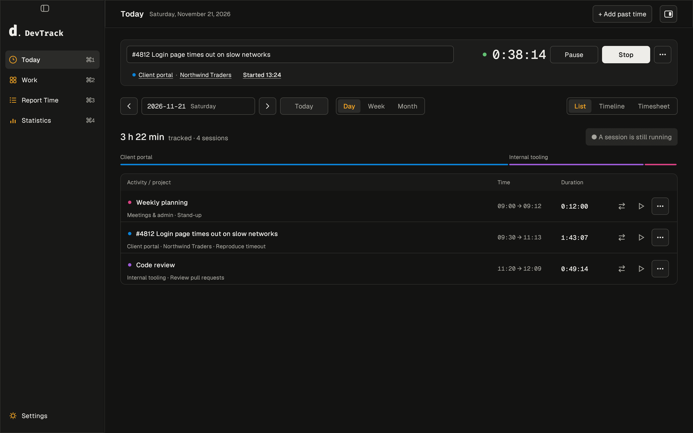
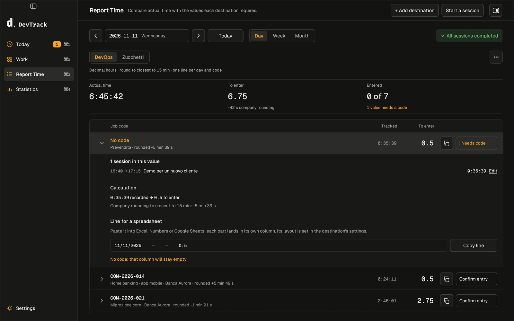
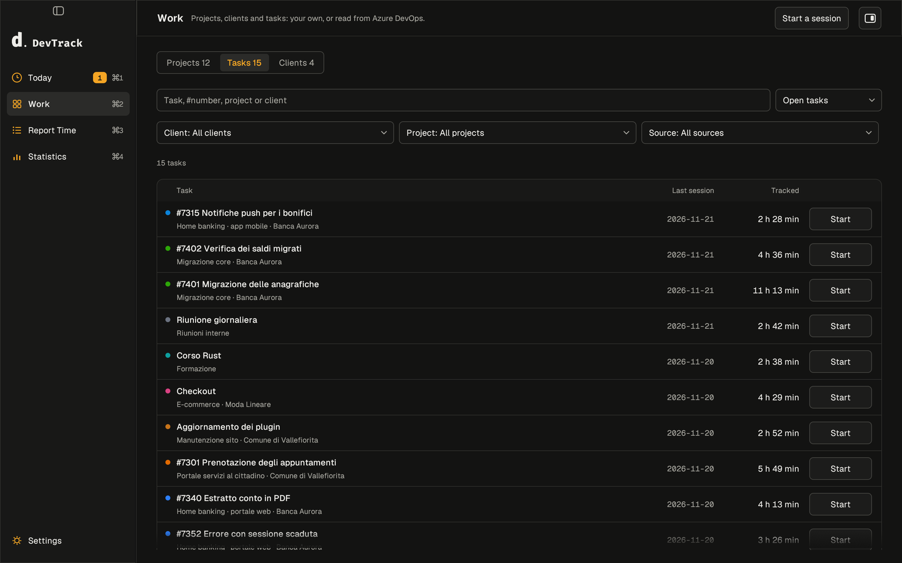

# DevTrack

*One tracked time, the right value for every system you report hours to.*

DevTrack is a desktop time tracker for developers and consultants. You track what you work on
once; DevTrack turns that real time into the value each timesheet expects (its format, its
rounding, its project codes) and can read your Azure DevOps work items, without ever changing
them.



## What it does

- **A timer that starts from the task.** Type what you are working on, pick a recent task or
  an Azure DevOps work item, and start. Project and client follow the task; pause, resume and
  change when a session started at any time.
- **Today, week and month.** Each period as a list, a timeline or a timesheet grid (project ×
  day), with the sessions that still need a project or a task called out.
- **Report Time.** For every destination (the systems you enter hours into), the value to type,
  in its own format and rounding, with project codes and exceptions per task. Copy a value, or a
  whole line for a spreadsheet, and mark it as entered.
- **Work.** Projects, clients and tasks in one place, with filters, colours and planned hours.
- **Azure DevOps, read-only.** Find the work items assigned to you, import them as tasks with
  their number and estimate, and keep them up to date. DevTrack only reads.
- **Statistics.** Time per day, project and task.
- **Sync between your devices** through a folder you already share (iCloud Drive, OneDrive,
  Dropbox, a network share). No server, no account.
- **A compact window** that stays above the others, a menu bar item on macOS, light and dark
  themes, and an interface in English and Italian.



## Install

**macOS and Linux**, in Terminal:

```sh
curl -fsSL https://brainupstudio.github.io/devtrack.site/install.sh | sh
```

**Windows**, in PowerShell:

```powershell
irm https://brainupstudio.github.io/devtrack.site/install.ps1 | iex
```

The script downloads the latest release, checks it against the published `SHA256SUMS.txt` and
installs it: on macOS in Applications, on Windows in `%LOCALAPPDATA%\Programs\DevTrack` with a
Start menu entry, on Linux in `~/.local/bin` with a menu entry. Installed this way, the system
opens DevTrack without the warning for apps from unidentified developers. The same command
updates an existing copy; your sessions and settings stay where they are. To install somewhere
else: `curl -fsSL …/install.sh | DEVTRACK_DIR=~/Applications sh` (or `$env:DEVTRACK_DIR` on
Windows).

You can also download the packages from the
[download page](https://brainupstudio.github.io/devtrack.site/#download) or the
[latest release](https://github.com/brainupstudio/devtrack.site/releases/latest). Downloaded
from a browser, the first time macOS says it cannot verify DevTrack: press **Done**, open
**System Settings › Privacy & Security** and, at the bottom, press **Open Anyway**. Once only.
On Windows, if "Windows protected your PC" appears, choose **More info**, then **Run anyway**.

Requires macOS 11 or later (Apple Silicon and Intel), Windows 10 or 11 (x64) or 64-bit Linux.
The Windows and Linux builds are previews: they are built and installed automatically, but not
yet tried on a real PC.

## Updates

Once a day DevTrack asks GitHub for the number of the latest release. On macOS, when a new
version is out it downloads it, checks it against the published checksums and installs it when
you quit DevTrack; **Restart to update** in the sidebar installs it at once. On Windows and
Linux it shows the new version with a link to the download page. You can turn the check off in
**Settings › General › Updates**.

## Privacy

DevTrack has no account and no analytics. It connects to the internet only for:

- the latest version number and the update itself, from GitHub;
- your Azure DevOps organisation, if you connect one (read-only);
- a time-tracking service whose address and token you type, if you import entries from one;
  neither is saved.

Your sessions, projects and settings stay on your computer, and in the shared folder if you
turn on sync. Tokens are kept in the system keychain, never in DevTrack's files.

## Where things are

| What | macOS | Windows | Linux |
| --- | --- | --- | --- |
| Data and settings | `~/Library/Application Support/DevTrack` | `%APPDATA%\DevTrack` | `~/.local/share/DevTrack` |
| Tokens | Keychain | Credential Manager | kernel keyring |
| A downloaded update waiting to be installed | `~/Library/Caches/DevTrack/update` | | |

Every save keeps the previous file as `data.previous.json`, next to `data.json`.

## Guide

[docs/guide.md](docs/guide.md) explains the pages, destinations and project codes, Azure
DevOps, sync, the settings and the keyboard shortcuts.



## Build from source

DevTrack is written in Rust with [egui](https://github.com/emilk/egui); the shared logic is the
`devtrack_core` library. With [rustup](https://rustup.rs) installed (Rust 1.87 or later):

```sh
cargo build --release
./target/release/devtrack
```

On Linux the window and file dialogs need `libxcb-render0-dev libxcb-shape0-dev
libxcb-xfixes0-dev libxkbcommon-dev libgtk-3-dev`.

`cargo test` runs the tests. `./target/release/devtrack --test` opens an empty copy of the app
with its own data folder, and `--demo` one filled with sample data, both next to your real data
and never mixed with it. `scripts/bundle-macos.sh --universal --dmg` builds DevTrack.app and the
disk image into `dist/`. [RELEASE.md](RELEASE.md) describes how a release is built for the three
systems and published; [DESIGN.md](DESIGN.md) describes the visual system.

## License

[MIT](LICENSE). The interface typefaces, Geist, Geist Mono and Fira Code, are under the SIL
Open Font License (`assets/fonts/OFL-LICENSE.txt`).
